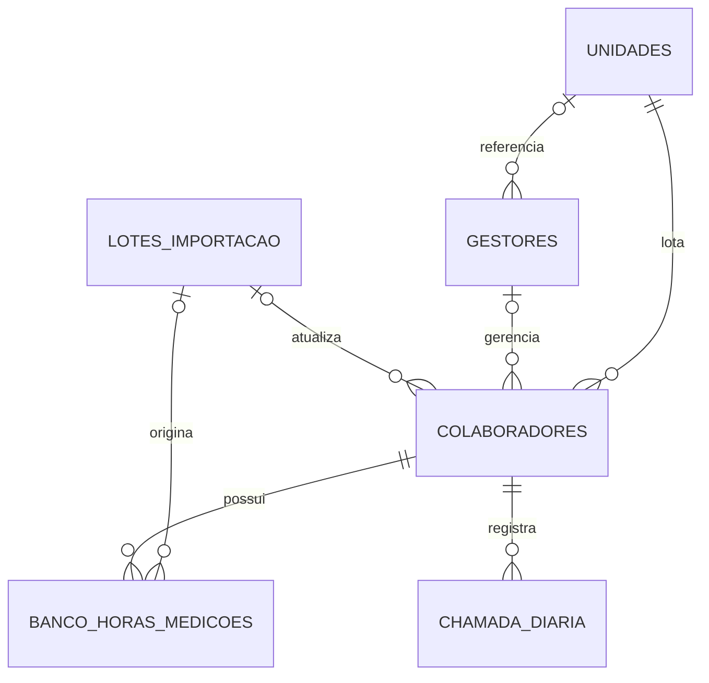

# Modelo de dados

> Modelo da etapa inicial. As migrations posteriores são a referência executável. O Monitoramento e suas permissões estão descritos em [MONITORAMENTO_ENTREGA.md](MONITORAMENTO_ENTREGA.md).

## Relacionamentos

## Tabelas

### `unidades`

- PK: `id uuid`.
- Unique: `codigo`.
- Campos principais: `codigo`, `nome`, `ativo`, timestamps.

### `gestores`

- PK: `id uuid`.
- FK opcional: `unidade_referencia_id -> unidades.id`.
- A unidade e apenas referencia cadastral; nao limita as unidades dos colaboradores gerenciados.

### `colaboradores`

- PK: `id uuid`.
- Unique: `matricula`.
- FKs: `unidade_id`, `gestor_id`, `ultimo_lote_importacao_id`.
- Dados atuais do Quadro Atual: nome, setor, funcao, situacao, categoria, admissao, movimento, jornada e observacao.
- Tempo de empresa e sempre calculado a partir de `admissao`.
- `NOVO_ADMITIDO` e uma situacao explicita, evitando uma flag redundante.

### `banco_horas_medicoes`

- PK: `id uuid`.
- FK obrigatoria: `colaborador_id`.
- Unique: `(colaborador_id, aplica_a_partir_de)`.
- `saldo_minutos` e a representacao canonica e assinada.
- `jornada_horas_dia` e snapshot da jornada usada no calculo.
- Cada linha e uma baseline historica; novas medicoes nao sobrescrevem as anteriores.

### `chamada_diaria`

- PK: `id uuid`.
- FK obrigatoria: `colaborador_id`.
- Unique: `(colaborador_id, data)`.
- `status` aceita somente `P/F/A/I/B/X/H/G/D/AF`.
- `created_by` e `updated_by` estao preparados e nullable ate a etapa de Auth.

### `lotes_importacao`

- Rastreia tipo, fonte, arquivo, referencia, estado e contadores.
- Nenhum upload ou importador foi implementado.

## Campos derivados

- Horas decimais e HH:MM sao formatacoes de `saldo_minutos`.
- Dias usam a jornada preservada na medicao.
- Dias a compensar, dias a repor e situacao do banco sao calculados nas views e no dominio TypeScript.
- Positivos e negativos sao agregados separadamente em `vw_banco_horas_resumo`.

## Views

- `vw_colaboradores_mensurados`: somente `ATIVO`, `FERIAS` e `NOVO_ADMITIDO` ativos no sistema.
- `vw_banco_horas_ciclos`: calcula limites, G do ciclo e pendencias por baseline.
- `vw_banco_horas_atual`: seleciona a baseline vigente de cada colaborador.
- `vw_banco_horas_resumo`: totais e quantidades positivos/negativos separados.
- `vw_chamada_diaria_contexto`: contexto cadastral sem duplicacao na tabela operacional.
